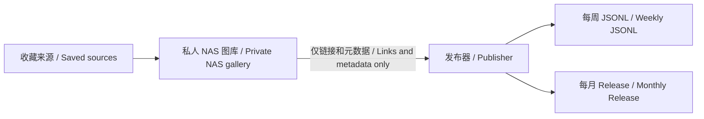

# 基于个人XP的grok bot帮我逛X收图项目 · Image Source Archive

## 中文

这是一个**个人爱好与学习用途的图片来源目录**，用于收藏grok bot打标过的图片的目录。

**本仓库只分享 JSONL 中的来源链接和元数据，不分发图片本身。** 仓库和 Release 均不包含原图、缩略图或图片压缩包。原始图片由来源网站提供；链接可能失效，或需要在来源网站登录才能访问。

**本仓库收纳的图片基于本人XP+grok bot理解的本人XP进行纯llm打标，如果与你的XP或者预期不符，请自行搭建管线，本项目不对产出数据质量做保证，更不对任何人的下议院做保证**

### 原理与流程

1. 先交给grok bot自己的X账号，然后设置XP，审核要求
2. 接着让grok bot每天白天隔3小时从首页刷100-150张图，逐张审核，剔除非人物、不够诱惑、不含xp、漏点的图。
3. 将通过的图提交到Cloudfare后端（一个由 queue+D1纯vibe实现的暂存队列）
4. 在NAS端消费这个队列
5. 每日数据汇总后，commit到此项目数据集，并push

- `weeks/YYYY-Www.jsonl`：每周一个文件，日常更新。
- `manifest.json`：文件目录、记录数、校验值和最后发布日期。
- 每月 Release：一个 `YYYY-MM.jsonl`，汇总上个月的入库记录。

JSONL 是“一行一条 JSON”的文本格式。每条记录包含来源图片 URL、原帖链接（如有）、作者、标签、原帖时间 `publishedAt` 和入库时间 `archivedAt`。周文件按入库时间分组，不代表图片一定是在该周创作或发布。

每天发布前会先 `git fetch`、`git pull`，再提交和推送。用户对 README 等说明文档的修改会保留；已发布的月度 Release 保留当时的快照。

## English

This is a **personal hobby and learning project** for organizing the sources of saved images.

**This repository shares source links and metadata in JSONL only. It does not distribute the images themselves.** Neither the repository nor its Releases include originals, thumbnails or image archives. Images remain on their source websites, where links may expire or require login.

### How it works

Saved source information is organized in a private NAS gallery. A publisher inside the main application exports metadata into this public catalog, as shown in the diagram above.

- `weeks/YYYY-Www.jsonl`: one file per archive week, updated daily.
- `manifest.json`: file index, record counts, checksums and publication date.
- Monthly Releases: a single `YYYY-MM.jsonl` containing records archived in the previous month.

JSONL is plain text with one JSON object per line. Records include the source image URL, original post URL when available, author, tags, original post time (`publishedAt`) and archive time (`archivedAt`). Weekly grouping follows archive time, not necessarily the creation or publication date of the image.

Before publishing, the application runs `git fetch` and `git pull`, then commits and pushes. User edits to README and other documentation are preserved. Published monthly Releases remain historical snapshots.
